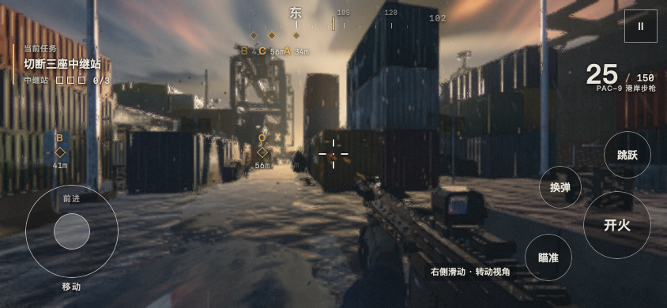

# Saltline 手机中文版

基于 **Claude Fable 5.2 生成的 Saltline** 做的汉化与手机浏览器适配，支持 iPhone Safari 横屏游玩。原游戏实验由 **Felix Rieseberg** 发起；本仓库保留原游戏并记录移动端改动。



## 已完成

- 中文菜单、任务、状态提示、操作说明与结算界面。
- 固定左摇杆前后左右移动；右侧滑动转向；按住开火，也可拖动开火键瞄准。
- 按触点编号独立管理移动、转向与射击，修复部分有效触点编号被误判为无效的问题。
- 横屏入口：正常横屏时适配可用区域，系统仍保持竖屏时提供页面内横屏布局；旋转保留当前任务。
- 保留原游戏音效，增加提示音、音效开关和测试声音按钮。

这是单人网页射击游戏。设备震动只在支持 `navigator.vibrate` 的浏览器上启用；iPhone Safari 使用音效和画面反馈。

## 本地运行

在仓库根目录运行，无需安装游戏依赖：

```sh
python3 -m http.server 8731 --bind 0.0.0.0
```

- 普通入口：`http://localhost:8731/`
- 横屏入口：`http://localhost:8731/play/`
- 手机试玩：连接同一局域网，将 `localhost` 换成运行服务的电脑的局域网 IP，并保持电脑与服务在线。

进入“开始任务”后，左手移动，右手滑动转向或按住开火；保留跳跃、换弹、瞄准和暂停。画面倒置时可在设置中点击“调转方向”。

## 验证情况

截至 2026-11-13：

| 检查 | 结果 |
| --- | --- |
| iPhone Safari 真机 | 用户确认可以移动，同时转向和开火；横屏版另获确认“横屏正常，移动和开火也正常” |
| WebKit 触控回归 | 24 / 24 通过 |
| WebKit 横屏检查 | 60 / 60 通过；原生点击与合成多指拖动 |
| Chromium 横屏检查 | 60 / 60 通过；CDP 原生多指事件 |
| 小屏及模拟安全区域布局 | 3 / 3 通过 |

自动化检查在 Mac 上运行，不等同于 iPhone 硬件测试。完整通关、持续帧率与发热尚未验证。详细改动与复现记录见 [MOBILE.md](MOBILE.md)。

## 维护与测试

`index.html` 是生成文件。改动 `mobile/` 或生成器后重新构建：

```sh
python3 tools/build_mobile.py
```

生成器读取固定的上游提交 `09c51774cd77aad750bd2d6c42af2b1020cb668d`。GitHub 上传版保存当前代码快照；首次克隆后，在重新构建前取回上游提交（直接试玩不需要此步骤）：

```sh
git fetch https://github.com/realcodebear/saltline-fable-5.2.git 09c51774cd77aad750bd2d6c42af2b1020cb668d
```

自动化脚本使用 Playwright；当前验证使用 `1.62.1`。可在仓库中安装测试依赖及浏览器：

```sh
npm install --no-save --package-lock=false playwright@1.62.1
npx playwright install chromium webkit
```

保持上述静态服务运行，再执行：

```sh
node tests/iphone-touch.cjs
node tests/landscape.cjs
SALTLINE_ENGINE=chromium node tests/landscape.cjs
```

可用 `PLAYWRIGHT_MODULE` 指定已有 Playwright 模块路径；`SALTLINE_URL` 指定待测入口，`SALTLINE_TEST_OUTPUT` 指定输出目录。默认结果写入忽略上传的 `test-results/`。

## 目录

| 路径 | 用途 |
| --- | --- |
| `index.html` | 完整游戏与生成后的汉化、触控适配 |
| `play/index.html` | 横屏容器 |
| `mobile/` | 触控实现、样式、中文操作说明、声音与触感适配 |
| `tools/build_mobile.py` | 从固定上游版本重建 |
| `tests/` | 触控与横屏回归脚本 |
| `docs/media/` | 实际游戏截图和项目封面 |

## 原作与许可状态

- 原游戏实验：Felix Rieseberg 使用 Claude Fable 5.2 生成。[作者原帖](https://x.com/felixrieseberg/status/2119925633564463609) · [原始作品](https://claude.ai/artifact/BGY1SztrAYcJQHSsnHHGmp)
- 上游镜像：[realcodebear/saltline-fable-5.2](https://github.com/realcodebear/saltline-fable-5.2)。原 README 完整保存在 [docs/UPSTREAM_README.md](docs/UPSTREAM_README.md)。
- 本仓库工作：汉化、手机触控修复、横屏适配、反馈设置与测试。
- 所用上游版本没有附带明确的游戏开源许可证；本仓库不自行替原作授予 MIT 等许可证，也不宣称已经取得商业发行授权。详见 [NOTICE.md](NOTICE.md)。

<details>
<summary>项目宣传封面</summary>


封面由 imagegen 参考实际游戏截图制作，手机外观与背景属于宣传设计，并非真机摄影。

</details>
